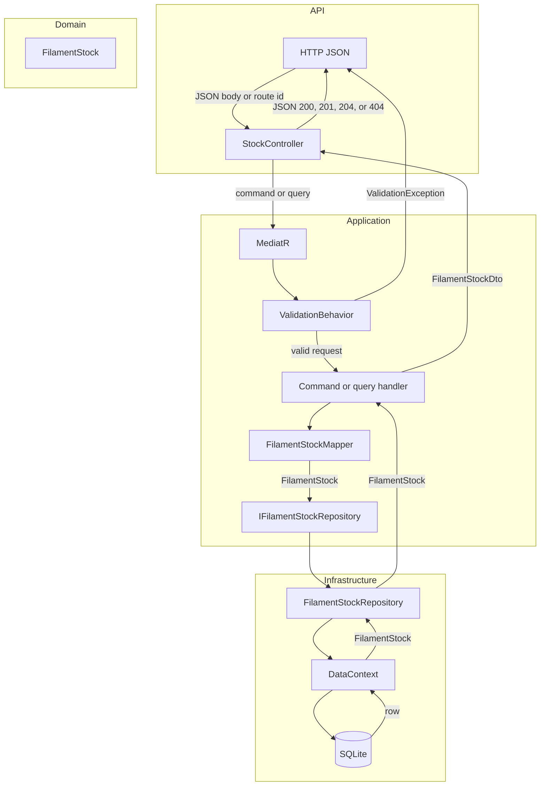

# Filament stock CRUD

11 October 2026

Filament stock is created, read, updated, and deleted through MediatR. `StockController` sends a command or query. A validation pipeline runs FluentValidation rules, then the handler calls `IFilamentStockRepository`. `FilamentStockRepository` in Infrastructure talks to SQLite through `DataContext`. Fields are copied by `FilamentStockMapper`; the solution does not use AutoMapper.

## How data moves between layers

A write (create or update) sends a command down and a DTO back up. A read sends a query and returns a DTO. The API never uses `DataContext`. The domain entity stays inside Application and Infrastructure.



| Step | From | To | What crosses the boundary |
| --- | --- | --- | --- |
| 1 | Client | `StockController` | JSON: `producer`, `type`, `color`, `quantity`, or an id in the route |
| 2 | `StockController` | MediatR | `CreateFilamentStockCommand`, `UpdateFilamentStockCommand`, `DeleteFilamentStockCommand`, `GetFilamentStocksQuery`, or `GetFilamentStockByIdQuery` |
| 3 | `ValidationBehavior` | Handler | The same request when rules pass. A failed rule becomes HTTP 400 and never reaches the handler |
| 4 | Handler | `IFilamentStockRepository` | `FilamentStock` from the domain, or an id |
| 5 | `FilamentStockRepository` | SQLite | The entity through `DataContext` |
| 6 | Handler | `StockController` | `FilamentStockDto`, a list of DTOs, null, or `false` when the row is missing |
| 7 | `StockController` | Client | JSON, or 404 / 204 with no body |

## Endpoints

| Method | Path | Result |
| --- | --- | --- |
| GET | `/api/stock` | List of filament stock |
| GET | `/api/stock/{id}` | One row, or 404 |
| POST | `/api/stock` | Created row, or 400 when validation fails |
| PUT | `/api/stock/{id}` | Updated row, 404 when missing, or 400 when validation fails |
| DELETE | `/api/stock/{id}` | 204, or 404 when missing |
| GET | `/api/filament-types` | List of filament types, sorted by name |

Producer, type, and color are required and limited to 100 characters. Quantity must be zero or greater. An update also requires an id greater than zero.

## Filament types

Type is chosen from the `FilamentTypes` table, not typed freely. `FilamentStock.Type` is still a text column holding the type name, with no foreign key. The create and update validators call `IFilamentTypeRepository.ExistsAsync` and reject a name that is not in the table with HTTP 400.

`FilamentTypesController` sends `GetFilamentTypesQuery`. The handler reads `IFilamentTypeRepository` and returns `FilamentTypeDto` (`id`, `name`). The Angular dialog uses this list for its Type dropdown.

`DataSeeder.SeedFilamentTypes` fills the table from `FilamentType.json` on startup when it is empty, before the stock seed runs. The seed holds PLA, PET-G, ASA, ABS, and TPU. Names are unique.

The API listens on `http://localhost:5100` from `launchSettings.json`.

## curl

List:

```bash
curl http://localhost:5100/api/stock
```

Get one row:

```bash
curl http://localhost:5100/api/stock/1
```

Create:

```bash
curl -X POST http://localhost:5100/api/stock -H "Content-Type: application/json" -d "{\"producer\":\"Prusa\",\"type\":\"PLA\",\"color\":\"Black\",\"quantity\":2}"
```

Update:

```bash
curl -X PUT http://localhost:5100/api/stock/1 -H "Content-Type: application/json" -d "{\"producer\":\"Prusa\",\"type\":\"PETG\",\"color\":\"Blue\",\"quantity\":3}"
```

Delete:

```bash
curl -X DELETE http://localhost:5100/api/stock/1
```

## Where the pieces live

- Repository contract: `SpooLLedger.Application/Abstractions/IFilamentStockRepository.cs`
- Filament type contract, query, and DTO: `SpooLLedger.Application/Abstractions/IFilamentTypeRepository.cs` and `SpooLLedger.Application/FilamentTypes`
- Filament type repository and seed: `SpooLLedger.Infrastructure/Repositories/FilamentTypeRepository.cs` and `SpooLLedger.Infrastructure/Data/Seed/FilamentType.json`
- Commands, queries, validators, and mapper: `SpooLLedger.Application/FilamentStock`
- Repository implementation: `SpooLLedger.Infrastructure/Repositories/FilamentStockRepository.cs`
- Handler and validator tests: `SpooLLedger.Tests`
- Angular page that lists stock: [filament-stock-page.md](filament-stock-page.md)
